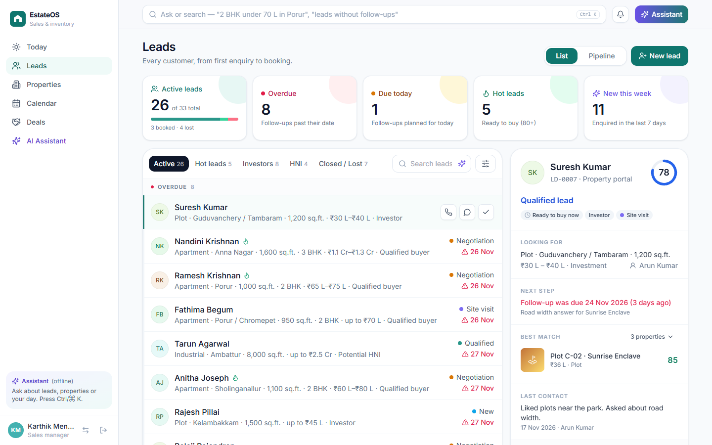
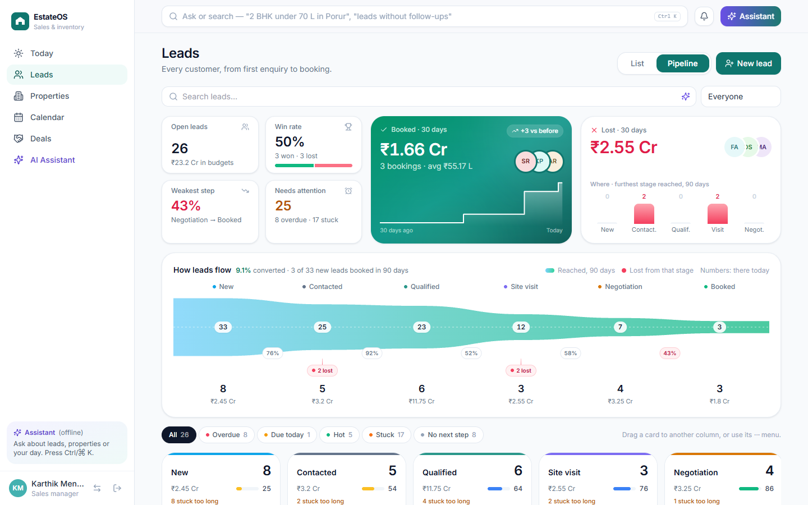
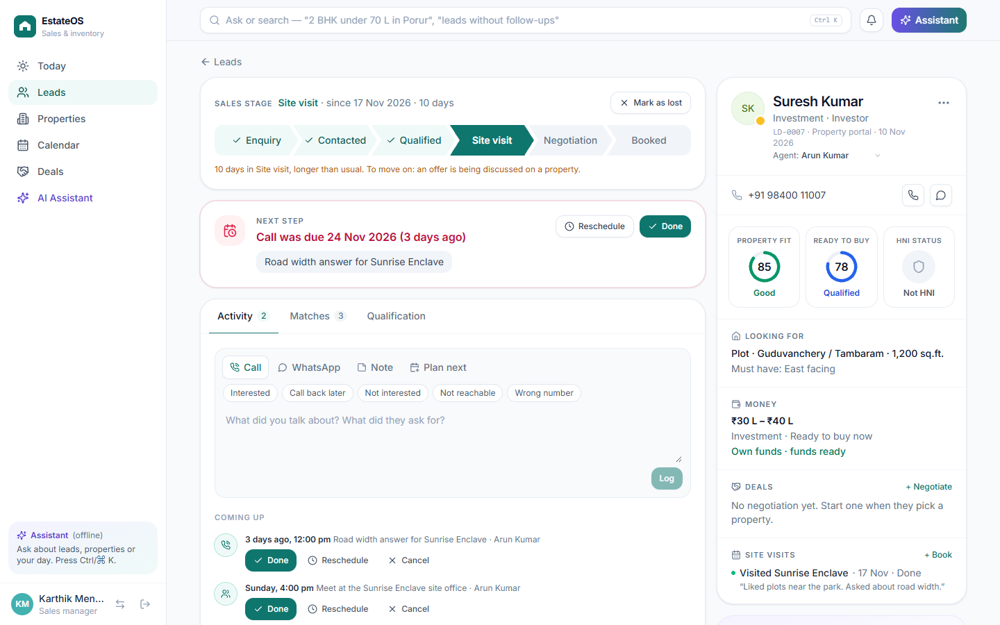
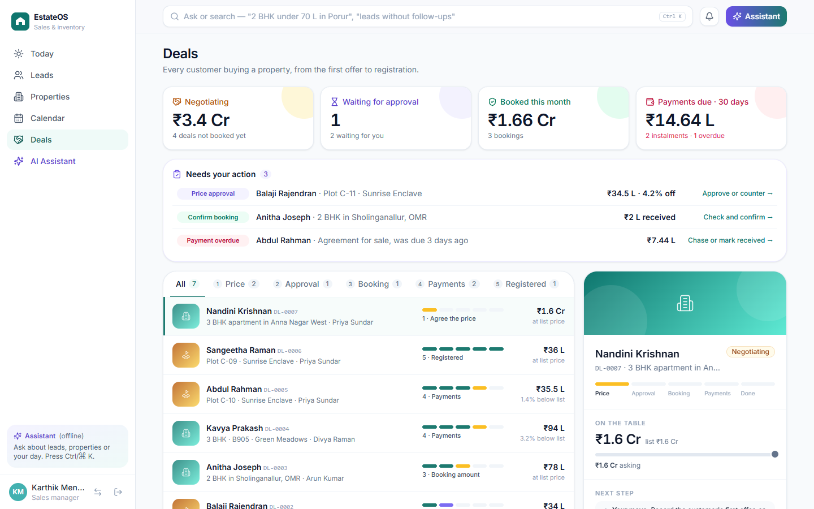
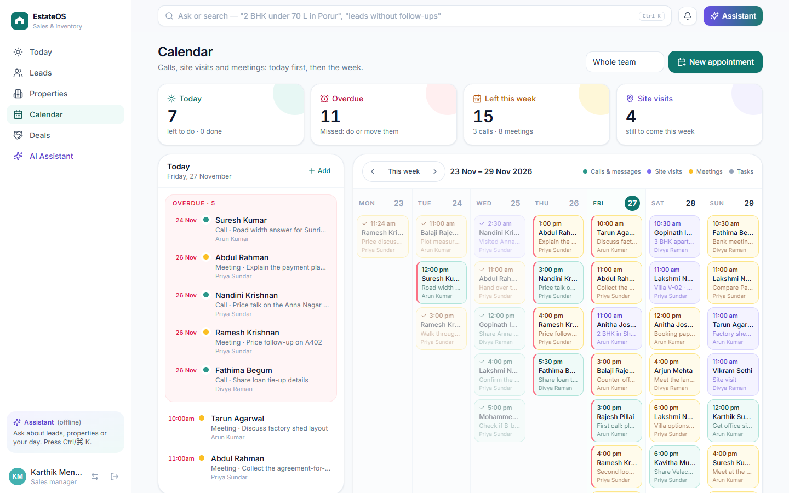
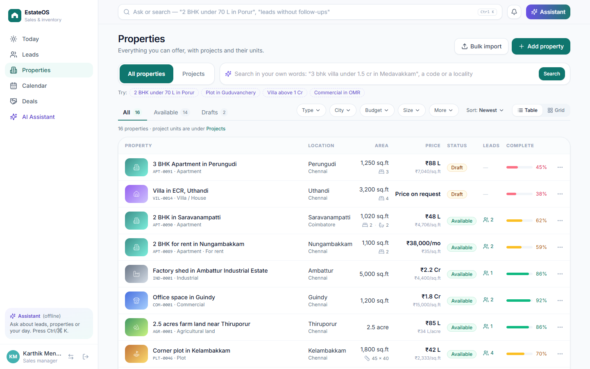
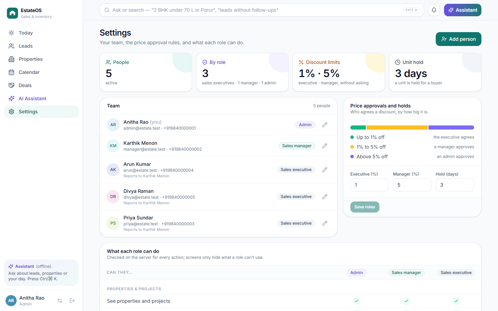

# 09 · UI patterns

How the screens are built, so a new page (or another AI tool) matches the ones
already there. Screenshots are in `docs/images/`, taken at 1440 × 900 as the
sales manager (Settings as admin) with the demo data.

## 1. The page shape

Most pages follow the same three layers:

1. **Header:** `PageHeader` (title, one-line subtitle, main action on the right).
   Switches such as *List / Pipeline* sit beside the action, using
   `Segmented size="lg"`.
2. **Tiles:** four or five numbers in a row (`grid-cols-2 lg:grid-cols-4`), each
   with a Lucide icon, a coloured label, a large number, a short hint and a soft
   coloured circle in the corner. A tile that filters the list below toggles on
   click.
3. **A list card with tabs**, and on wide screens (`xl`) a **preview panel** on
   the right for the selected row. Row actions (Call, WhatsApp, Done) show on
   hover or keyboard focus only.

## 2. Screens and where they live

| Screen | File | Notes |
|---|---|---|
| Leads list | `pages/Leads.tsx` | Tiles, tabs, rows grouped by due date, preview panel |
| Pipeline | `features/pipeline.tsx` | Outcomes row (status 2 × 2, Booked, Lost), flow band, columns |
| Lead page | `pages/LeadDetail.tsx` | Two columns; most parts come from slots |
| Deals | `pages/Deals.tsx` | Tiles, *Needs your action*, step tabs, preview panel |
| Calendar | `pages/Calendar.tsx` | Tiles, Today card on a time rail, week grid |
| Properties | `pages/Properties.tsx`, `PropertyList.tsx`, `ProjectsTab.tsx` | Shared search row, status tabs with filters, table or grid |
| Property page | `pages/PropertyDetail.tsx`, `components/property/*` | Collage, five tabs, neighbourhood explorer |
| Settings | `pages/Settings.tsx` | Tiles, team, approval ladder, permissions table |
| Today | `pages/Today.tsx` picks `TodayExec`, `TodayManager` or `TodayAdmin`; tiles in `components/Bento.tsx` | Bento tiles; greets by first name |

## 3. Shared pieces (use these before writing new ones)

| Piece | Where | Use |
|---|---|---|
| `Button`, `Input`, `Select`, `Field`, `Badge`, `Avatar` (`soft`, `size="lg"`), `Modal`, `Drawer`, `Segmented` (`size="lg"`), `EmptyState`, `ErrorNote`, `PageLoader` | `components/ui.tsx` | Standard controls |
| `SearchBar` | `components/SearchBar.tsx` | The search row on Properties and Projects |
| `ScoreRing`, `BAND_STYLE`, `StageLabel`, `STAGE_DOT`, `budgetText`, `whatAndWhere`, `shortDate`, `daysFromToday`, `matchTone` | `components/leadBits.tsx` | Anything that shows a lead |
| `StepTrack`, `PriceTrack`, `NextStepNote` | `components/DealSteps.tsx` | Anything that shows a deal |
| `Tile`, `TileHead`, `DayHeadline`, `greeting()`, the dashboard tiles | `components/Bento.tsx` | Today dashboards |
| `useConfirm()`, `useToast()` | `components/confirm.tsx`, `components/toast.tsx` | Never the browser's alert, confirm or prompt |

The small page `Tile` (icon, label, number, hint, corner circle) is copied in
`Deals.tsx`, `Calendar.tsx` and `Settings.tsx`; moving it to one shared file is
on the frontend-review list.

## 4. Look

- **Cards:** `rounded-3xl border border-slate-200/80 bg-white shadow-card`; a card
  header is `border-b border-slate-100 px-5 py-3.5` with a `text-sm font-semibold`
  title and a `text-xs text-slate-500` line under it.
- **Tiles:** `rounded-2xl`, the same border and shadow.
- **Section labels:** `text-[11px] font-semibold uppercase tracking-[0.08em] text-slate-400`.
- **Numbers:** `tabular-nums`; money with `formatINR` from `@estate/shared` (₹ lakh / crore).
- **Colours by meaning:**

| Colour | Means |
|---|---|
| teal (`brand-*`) | the brand, main actions, the active choice |
| emerald | booked, won, done, "yes" |
| rose | lost, overdue, errors |
| amber | today, waiting, a warning |
| violet (`ai-*`) | AI and approvals (there is no `ai-400`; use `ai-500`) |
| sky / blue | early stages, information |

- **Icons:** Lucide only.
- **Inline styles** only for computed sizes (bar widths), marked
  `/* scan-ok: reason */` so the frontend scanner accepts them.

## 5. Adding to a page without editing it

Feature modules register parts in the slot lists, and the page draws whatever is
registered:

- `slots.ts`: `propertyTop`, `propertySide` (property page).
- `slots-leads.ts`:
  - `hero`: inside the lead header (the stage bar);
  - `next`: under the stage (the next step);
  - `top`, `actions`;
  - `side`: sections of the profile card (site visits, deals);
  - `tabs`: extra tabs after Activity, `{ key, label, useCount?, C }` (Matches);
  - `views.board`: the Pipeline view on the Leads page.

Registration happens in `features/*.tsx`, e.g.
`leadSlots.tabs.push({ key: 'matches', label: 'Matches', useCount: useMatchCount, C: LeadMatches })`.

## 6. Phones

- The sidebar becomes a bottom bar; the role switch is a *Role* tab there.
- Preview panels show only at 1280 px and wider (`useMedia('(min-width: 1280px)')`); below that a row opens the full page.
- Pipeline cards move through their *Move to…* menu (touch drag isn't supported).
- The Calendar shows a day picker; the Today card keeps only the overdue part.
